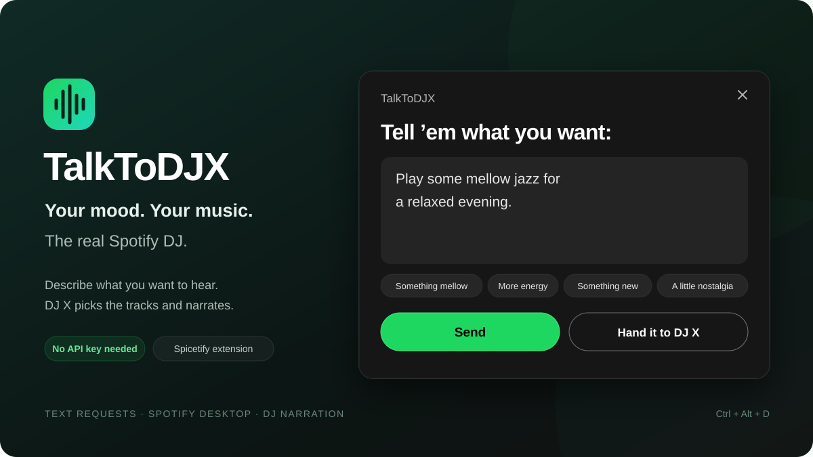

# TalkToDJX

Send a text prompt to **the real Spotify DJ X** from Spotify desktop. Describe the music you want, and Spotify picks the tracks and supplies its own DJ narration.



**Spicetify extension · Version 1.3.2 · GitHub repository: SpicetifyTalkToDJX**

## Install from Spicetify Marketplace

1. Open **Marketplace** in your Spicetify-enabled Spotify desktop app.
2. Select **Extensions** and search for **TalkToDJX**.
3. Click **Install**, then reload Spotify when prompted.

New listings can take time to appear in Marketplace's GitHub search results. If the extension is not visible yet, use the manual installer below.

DJ requests require Spotify Premium and an account/region where Spotify has enabled this feature. Installing the extension does not enable DJ for unsupported accounts.

## Use it

- Click Spotify's **blue DJ button** in the player to open the request panel. It now opens the menu instead of immediately changing the set.
- You can also use the **waveform button** in Spotify's top bar, or press **Ctrl + Alt + D**.
- Describe what you want: a mood, an artist, a genre, an activity, or a mix of favorites and discoveries.
- Click **Send**, or press **Ctrl + Enter**. The panel closes immediately, and DJ handles the request in the background. DJ starts automatically if you are listening to something else.
- **Hand it to DJ X** closes the panel and lets DJ change the set without a prompt.
- All four smaller suggestion cards fit in one non-scrollable row directly below the input.
- **Send** and **Hand it to DJ X** have equal widths and together span the input box's width.
- Click outside the panel or press **Escape** to close it. An unsent draft stays available until you submit or restart Spotify.
- The same blue DJ button stays available in the player's horizontal control row during DJ narration and music. You can also open **TalkToDJX** from your profile menu.

Example: “Play some mellow jazz for a relaxed evening.”

Windows voice typing (**Win + H**) can dictate into the prompt box. The extension submits text; Spotify's mobile microphone interface is not embedded here.

## Requirements

- Spotify desktop with Spicetify installed and its APIs exposed.
- A Spotify Premium account with DJ requests available in its region.
- A connected playback device that supports DJ narration. This computer is supported.

No API key, separate account login, AI subscription, or background server is needed. Your existing Spotify session handles authentication. Prompts go directly to Spotify. The extension no longer records recent requests; unsent drafts are held only in memory.

## Manual install / update

Download and extract this repository using **Code → Download ZIP** on GitHub, or clone it. Open a terminal in the extracted folder and run, with Node.js installed:

```powershell
node install.mjs
```

The installer copies `talk-to-dj.js` into your Spicetify `Extensions` folder, adds it to your existing extension list, and runs `spicetify apply`. Spotify restarts.

The extension is a standalone JavaScript file; Node.js is only needed for the installer and development tools. Its filename remains `talk-to-dj.js`, so existing manual installations can be updated in place.

For Spicetify **2.45.3**, it also installs two small React startup compatibility patches in the config's `[Patch]` section. These prevent Marketplace's navigation from rendering before Spicetify exposes React on Spotify 1.3.3 / 1.3.4. The patches use the native React exports and remain available after uninstalling the extension, because Marketplace also needs them. A config backup is saved before the installer changes those patches.

To apply without restarting immediately:

```powershell
node install.mjs --no-restart
```

Uninstall:

For a Marketplace installation, use **Marketplace → Installed → TalkToDJX → Remove** and reload Spotify. For a manual installation:

```powershell
node install.mjs --uninstall
```

If a Spotify update removes Spicetify, restore Spicetify first, then run the installer again.

## How it works

The extension uses Spotify's authenticated `Platform.RequestBuilder` to call:

```text
POST /dj-interaction-manager/spotify.dj.interactionmanager.v0.DJInteractionManagerService/ResolveInteractiveContext
```

The protobuf request uses the Android app's field numbers: prompt (1), current playback session ID (2), active Connect device ID (3), segment ID (4), retries left (5), submission reason (6), track URI (7), and input type (8). Text input is enum value `2`; the default submission reason is request prompt (`0`). Spotify updates the active device's DJ session itself.

The panel closes on submission without showing loading, success, or error messages. HTTP and protobuf replies are handled in the background for diagnostics. A delayed reply does not lock the panel or prevent another request; submitting uses the current DJ session. The extension does not automatically retry a request that may already be changing playback.

This is an internal Spotify API, so Spotify updates can change it. `TalkToDJX.getStatus()` in developer tools reports outstanding background requests and the latest error code without displaying them in the panel. `TalkToDJ` remains available as a compatibility alias for existing development tools.

## Verification

```powershell
node --check talk-to-dj.js
node --check install.mjs
node --test tests/talk-to-dj.test.cjs tests/compat.test.mjs
```

Live development tools in `tools/` can inspect a local Spotify instance started with `--remote-debugging-port=9222`. They are not required for normal use. `tools/cdp.mjs` evaluates JavaScript in that local instance; do not pass authentication tokens to its output.

Tested locally with Spotify **1.3.3.264 / 1.3.4.258** and Spicetify **2.45.3**. A live prompt returned `OK / success` and DJ X introduced a matching smooth-jazz set.

## Marketplace publishing

The public **SpicetifyTalkToDJX** GitHub repository contains a root `manifest.json` with the listing name **TalkToDJX**, this README, a preview image, and the standalone extension. The repository's `spicetify-extensions` topic makes it discoverable by Marketplace. Marketplace uses the `main` branch for this listing.
